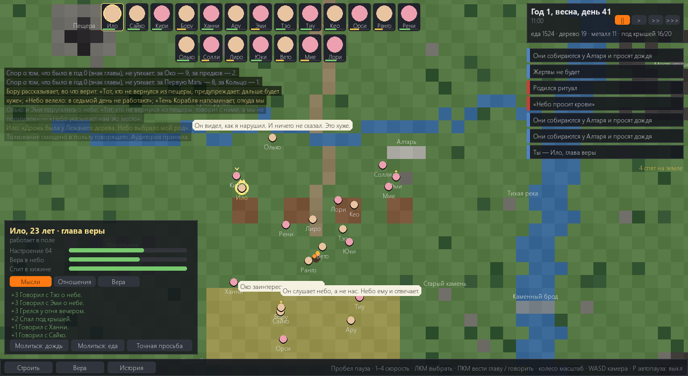

**A colony sim about a god who is really a broken machine.**

A colony ship crashed near an alien world. Generations later, the survivors' descendants live as a tribe and remember nothing
of where they came from. You are the ship's half-broken AI, still hanging in orbit.

You can't give orders. You can call rain, strike with lightning, drop a supply capsule, light up a place at night.
What it *means* is up to them. Lightning lands next to a thief, and now "the sky punishes thieves". A few generations later
nobody remembers the thief, but the custom is still there.

*Playable prototype, year 1: the tribe gathers at the Altar to ask for rain. The left panel shows Ilo, the head of the faith, and his thoughts.*

## Design pillars

1. **Faith grows out of events.** No doctrine is picked from a menu; every belief comes from something that happened.
2. **Every story has a cause.** Any belief, ritual or feud can be traced back to the event that started it.
3. **You are a god who isn't one.** You have power but no control: people decide for themselves what your signs mean.

## What already works

- Top-down colony map: people follow daily routines (field, water, altar, evening fire, sleep) and avoid places under taboo.
- Interventions (rain, lightning, light, capsule) with real consequences, seen only by those who were actually nearby.
- **The Hearer**: once the ship's link is 30% repaired, one person starts hearing it and interprets your signs according to their character.
  That's how customs are born, and how a prophet can turn proud, invent signs, or go mad.
- Moral crises: a sacrifice during drought, an exile during fever, and you can try to stop them.
- **The Chronicle**: after 150 years, the ship's dry log stands next to how the tribe now remembers the same day:

> **Ship's log.** Capsule No. 6. Manifest: Radio Operator Lan. No exit recorded.
>
> *Tribal chronicle, retold for the 4th generation:* The Cave is where a man went back to the sky. People leave food at its entrance.
> Who he was, no one remembers.

## Status

Early prototype (Python + pygame), with the design document, lore and branding in progress. The source code is private for now.
Development is logged in a devlog, and updates will land here.

Made by [Artur](https://github.com/azmixZ).
